# **Fintech Payment Performance Analysis**
## **One Question Projects — Project 05**

## **Project Overview**
This project simulates a payment performance analysis scenario for a fintech company operating in the digital payments industry, similar to Fawry or Paymob. Using a synthetic dataset of payment transactions, the project evaluates payment performance and investigates patterns associated with transaction failures. The analysis uses Python to examine Payment Success Rate across different payment methods, transaction channels, merchant categories, transaction values, and times of day, aiming to identify segments with elevated failure rates and highlight potential areas for operational improvement.

## **Business Problem**
Payment failures can disrupt customer experiences, reduce completed transactions, and create additional operational friction for payment providers and merchants. However, an overall failure rate alone does not reveal where these problems are concentrated or which transaction characteristics are associated with a higher likelihood of failure. Without a segmented analysis of transaction performance, it can be difficult to identify the areas that require further investigation and operational improvement.

## **Project Goal**
The goal of this project is to evaluate payment performance by measuring the overall Payment Success Rate and comparing transaction outcomes across key operational dimensions. The analysis aims to identify segments with relatively high failure rates, examine the distribution of failure reasons, and generate actionable business insights that can help prioritize further investigation into payment reliability.

## **Project Business Question**
What factors are associated with payment failures, and which transaction segments exhibit the highest failure rates?

## **Dataset Description**
The dataset contains 30,000 payment transactions simulated for a fintech company operating in the digital payments industry. It consists of 10 columns covering transaction details, customer and merchant identifiers, payment methods, transaction channels, merchant categories, transaction amounts, transaction outcomes, and failure reasons.

The dataset supports the analysis of Payment Success Rate across multiple operational dimensions, helping identify transaction segments with elevated failure rates and explore patterns associated with unsuccessful payments.

| Column | Description |
|---|---|
| `transaction_id` | Unique identifier assigned to each payment transaction. |
| `customer_id` | Identifier of the customer initiating the transaction. |
| `merchant_id` | Identifier of the merchant receiving the payment. |
| `transaction_date` | Date and time when the transaction occurred. |
| `payment_method` | Payment method used to complete the transaction. |
| `amount` | Monetary value of the transaction. |
| `channel` | Channel through which the transaction was initiated, such as a mobile app, website, or POS terminal. |
| `merchant_category` | Business category of the merchant. |
| `status` | Final transaction outcome, recorded as Success or Failed. |
| `failure_reason` | Recorded reason for a failed transaction, where available. |

## **EDA & Baseline KPIs**
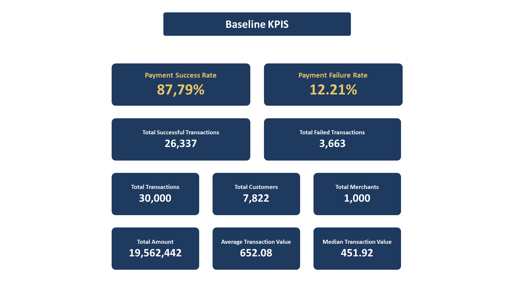
- The dataset contains **30,000 transactions** generated between **January 1 and March 30, 2026**, involving **7,822 unique customers** and **1,000 merchants**. The total transaction value is **19.56 million**, with an **average transaction amount of 652.08** and a **median of 451.92**.
- Regarding payment performance, **26,337 transactions were successful (87.79%)**, while **3,663 transactions failed (12.21%)**. Although the overall success rate provides a useful performance baseline, it does not reveal whether failures are concentrated in specific payment methods, transaction channels, merchant categories, transaction amounts, or times of day. These dimensions will be examined in the subsequent analysis to identify segments associated with elevated failure rates.
---
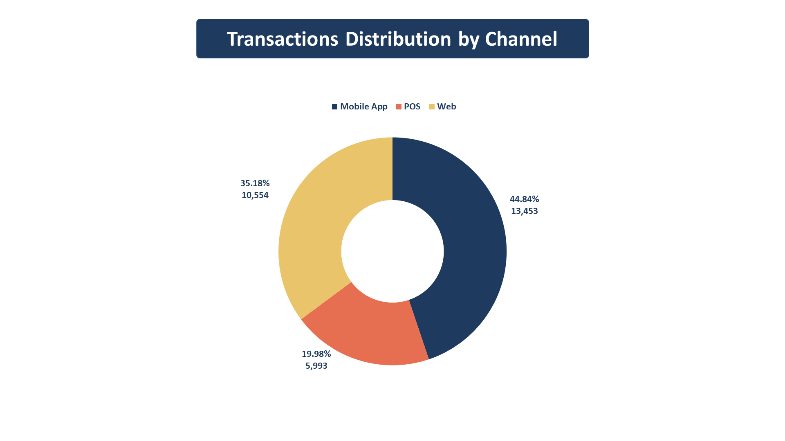
- The **Mobile App** accounts for the largest share of transactions (**44.84%**), followed by **Web (35.18%)** and **POS (19.98%)**, indicating an uneven distribution of transaction volume across channels.
---
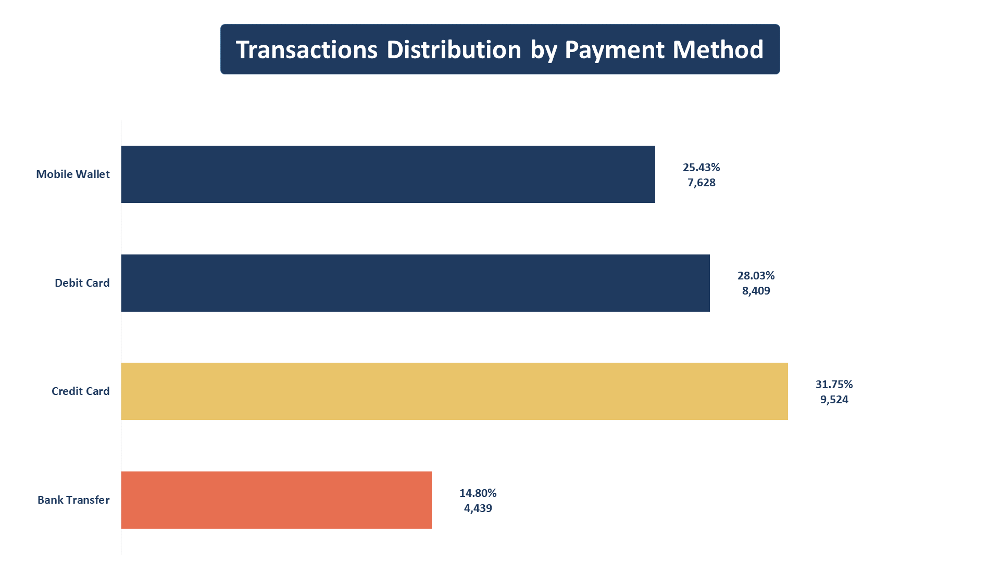
- **Credit Card** accounts for the largest share of transactions (**31.75%**), followed by **Debit Card (28.03%)**, **Mobile Wallet (25.43%)**, and **Bank Transfer (14.80%)**, indicating differences in transaction volume across payment methods.
---
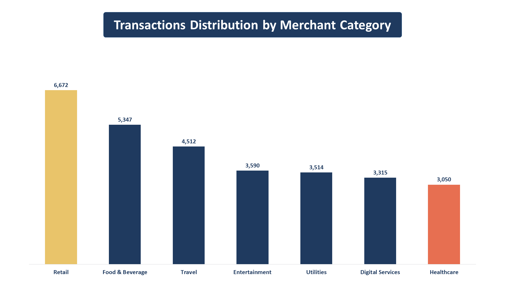
- **Retail** accounts for the largest share of transactions **(22.24%)**, followed by **Food & Beverage (17.82%)**, while the remaining merchant categories each contribute between **10.17% and 15.04%**, indicating a moderate concentration of transaction volume in Retail and Food & Beverage.
---
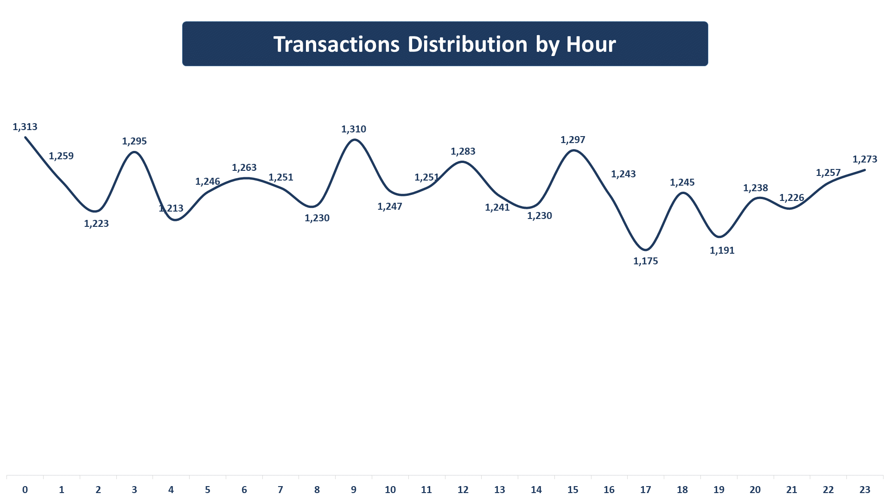
- The hourly transaction distribution remains relatively stable throughout the day, with transaction counts ranging from **1,175 to 1,313 per hour** and no substantial fluctuations in overall activity.
---
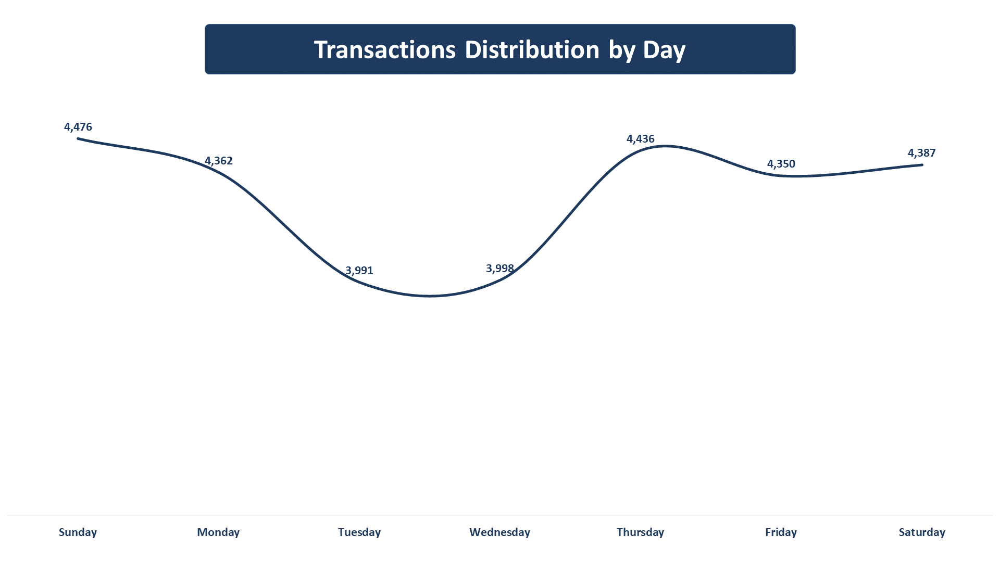
- The day-of-week transaction distribution is relatively stable, with daily transaction counts ranging from **3,991 on Tuesday** to **4,476 on Sunday**, indicating no substantial variation in transaction volume across the week.

## **Analysis**
The analysis focuses primarily on Payment Failure Rate to evaluate payment performance across different transaction segments. While the overall number of failed transactions provides a measure of the scale of payment failures, it does not account for differences in transaction volume between segments. Failure Rate addresses this limitation by measuring the proportion of transactions that fail within each segment, enabling fairer comparisons across payment channels, methods, merchant categories, transaction amounts, and time periods. The analysis also examines each segment's contribution to total failed transactions to provide additional context on the overall impact of payment failures.
### **Failure Rate by Channel**
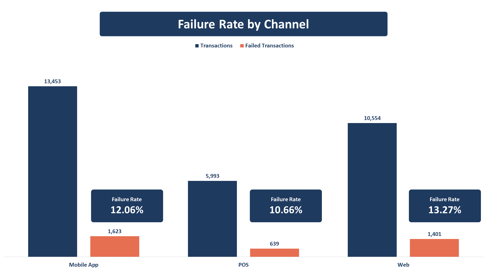
- The analysis shows differences in payment failure rates across transaction channels. The **Web** channel recorded the highest failure rate at **13.27%**, followed by the **Mobile App** at **12.06%**, while **POS** had the lowest rate at **10.66%**. Despite having a lower failure rate than **Web**, the **Mobile App** recorded the **highest number of failed transactions (1,623)**, compared with **1,401 on Web** and **639 on POS**. This highlights the importance of examining both failure rates and transaction volumes when evaluating payment performance across channels.
- To complement these findings, the next step will calculate each channel's **Share of Total Failures** to determine its contribution to all failed transactions. This will provide additional context alongside the failure rate and help distinguish between channels with a high failure rate and those contributing a larger share of total failures.
### **Channel's Share of Total Failures**
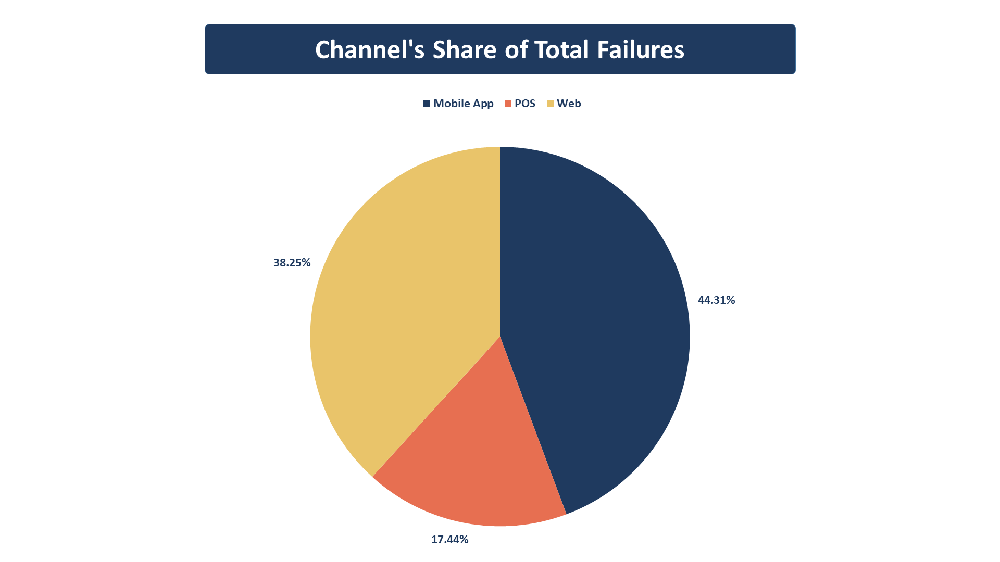
- The **Mobile App** accounted for **the largest share** of total failed transactions, contributing **44.31% of all failures**, followed by **Web at 38.25%** and **POS at 17.44%**. Although **Web** recorded **the highest failure rate** within its own transactions, the **Mobile App contributed a larger share of total failures**, reflecting its higher transaction volume. These findings highlight the importance of examining both failure rates and failure contributions to understand payment performance across channels.
### **Failure Rate by Payment Method**
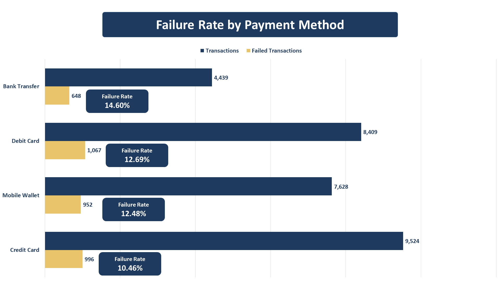
- Payment failure rates vary across payment methods, with **Bank Transfer** recording the highest failure rate at **14.60%**, followed by **Debit Card at 12.69%**, **Mobile Wallet at 12.48%**, and **Credit Card at 10.46%**.
- Notably, **Bank Transfer** has the lowest transaction volume (**4,439 transactions**) but the highest failure rate, while **Credit Card** has the highest transaction volume (**9,524 transactions**) and the lowest failure rate. The **4.14 percentage-point** gap between the highest and lowest failure rates indicates a more pronounced variation across payment methods than across transaction channels, suggesting that payment method is an important dimension to investigate when evaluating payment failures.
### **Payment Methods Share of Total Failures**
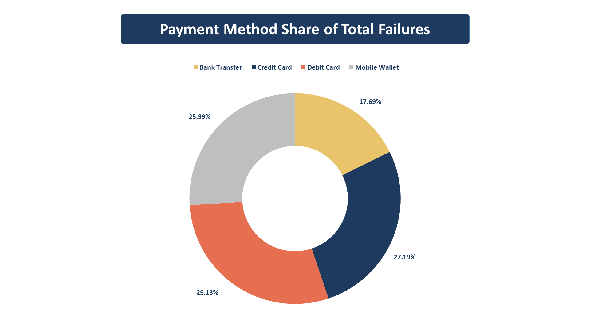
- **Debit Card** accounted for the largest share of total failed transactions, contributing **29.13%** of all failures (**1,067 transactions**), followed by **Credit Card at 27.19%**, **Mobile Wallet at 25.99%**, and **Bank Transfer at 17.69%**.
- Despite having the highest failure rate, Bank Transfer contributed the smallest share of total failures due to its lower transaction volume. In contrast, Debit Card contributed the largest number of failures, although its failure rate was lower than that of Bank Transfer. This highlights the importance of considering both failure rates and transaction volumes when assessing payment performance and prioritizing areas for further investigation.
### **Failure Reason's Share of Total Failures**
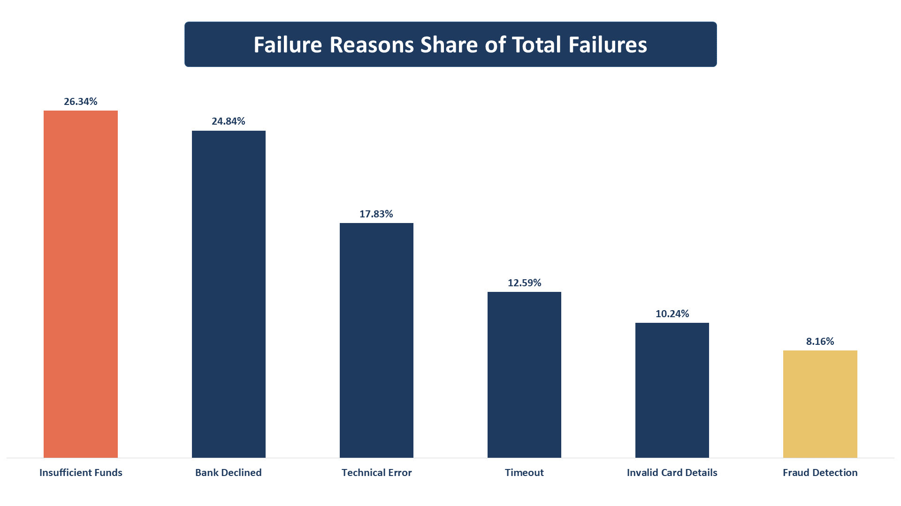
- **Insufficient Funds** was the most common failure reason, accounting for **26.34%** of all failed transactions (**965 cases**), followed by **Bank Declined** at **24.84%** (**910 cases**). Together, these two reasons represented **51.18% of total failures**. **Technical Error** ranked third at **17.83%**, followed by **Timeout at 12.59%**, **Invalid Card Details at 10.24%**, and **Fraud Detection at 8.16%**.
- The distribution indicates that payment failures are concentrated primarily in insufficient funds and bank declines, while technical and other reasons account for the remaining failures. These findings identify the most frequent failure categories and provide a basis for investigating how failure reasons vary across transaction channels and payment methods.